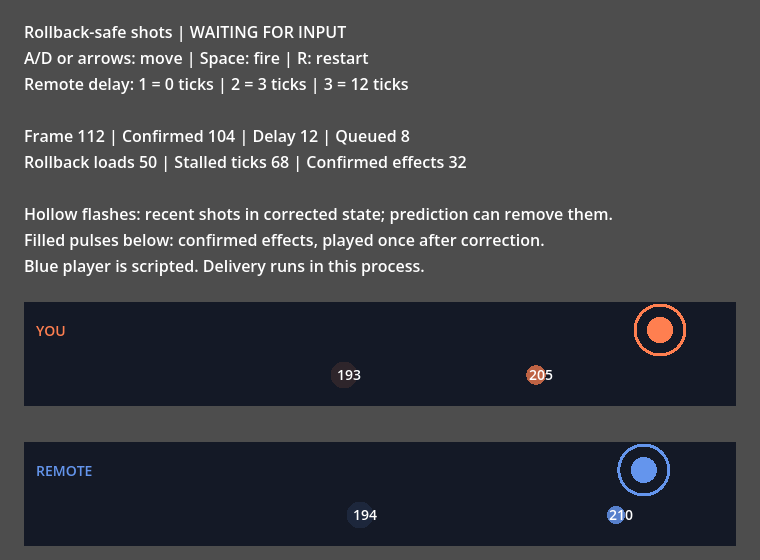

# Add rollback to your game

This guide covers what your game must provide and how to call the library each frame.
The code lives in [`examples/integration/`](../examples/integration/):

- [`game.gd`](../examples/integration/game.gd): two players move left/right and fire shots.
- [`loop.gd`](../examples/integration/loop.gd): one local player against one remote player.
- [`effects.gd`](../examples/integration/effects.gd): calls your `play()` hook once per confirmed shot.
- [`integration.tscn`](../examples/integration/integration.tscn): playable shots with delayed remote input.

[`test_integration_example.gd`](../tests/unit/test_integration_example.gd) runs this code with late remote input,
prediction stalls and rollback. It compares the result with a straight replay of the actual inputs.

## Try the effects example

```sh
godot --path . res://examples/integration/integration.tscn
```

Move with **A/D** or the **arrow keys** and hold **Space** to fire. The blue player follows scripted inputs.
Press **1**, **2** or **3** for remote-input delivery delays of **0**, **3** or **12** physics ticks.
Press **R** to restart with the selected delay and a fresh effects ledger.
Press **P** to pause and watch a replay of the confirmed frames so far. It starts from a fresh game,
checks every recorded checksum and ends on the corrected state. Press **P** again to return to the match.
This example delivers input in process and needs no server or SignalFish SDK.

Hollow flashes show recent shots from the current, corrected simulation. Prediction can create a flash
that disappears when the remote player's actual input arrives. Filled pulses below each lane represent
one-time confirmed effects; each is labeled with its stable shot ID. They wait for confirmation and correction,
then play once. The effect counter never rewinds or counts resimulation as another shot.
At 12 ticks of delay, the eight-frame prediction window fills and movement waits for input.
The queued input, rollback-load and stalled-tick counters show that recovery continues.
Changing delay preserves already queued deliveries; reducing delay can take time to clear the old queue.

`demo.gd` drives the same game, loop and effects ledger as the guide. It keeps a bounded delivery queue
and a bounded recent-effects history. The renderer reads corrected state after each step, including a stall
that corrected earlier frames. Its filled pulses replace audio so the confirmation behavior is visible without speakers.



To run it from a clean project containing only the addon and this example, run from the repository root:

```sh
DEMO_DIR=$(mktemp -d)
mkdir -p "$DEMO_DIR/addons" "$DEMO_DIR/examples"
cp project.godot "$DEMO_DIR/"
cp -R addons/fortress_rollback "$DEMO_DIR/addons/"
cp -R examples/integration "$DEMO_DIR/examples/"
godot --headless --path "$DEMO_DIR" --editor --import
godot --path "$DEMO_DIR" res://examples/integration/integration.tscn
```

Use a Godot 4.3 or newer executable for both commands. No Rust toolchain or native extension is needed.

## Install

1. Use Godot 4.3 or newer.
2. Copy `addons/fortress_rollback` into your project's `addons` directory.
   It needs no editor plugin, autoload, Rust or native extension.
3. Set **Physics > Common > Physics Ticks Per Second** to **60** and call the library from `_physics_process`.

Preload `core/config.gd`, `core/session.gd` and `core/driver.gd`.
Online play adds a transport: see the [byte session guide](peer-session.md).
The [online example setup](online-example.md#install-and-run) creates a separate project,
installs the optional SDK, configures a local server, exports Web and hosts HTTPS/WSS.
It includes a missing-SDK check before adding online dependencies.

## What your game provides

Your game is an object with three methods. The driver calls them; your game never calls them itself.

| Method | Contract |
| --- | --- |
| `save_state(frame, writer)` | Write the complete state for `frame`. Return `Driver.SaveResult.new(ok, checksum)`. |
| `load_state(frame, reader)` | Read a snapshot back. Return `false` if it is invalid. |
| `simulate_frame(frame, inputs)` | Read every player's input with `inputs.read(player)` and advance exactly one frame. |

`current_frame` is the next frame to simulate. Saving frame F stores the state before input F.
Simulating input F produces the state for frame F + 1.

### Inputs

Each player's input is a fixed number of bytes, the same for every player and frame.
Pack buttons into bits: the example uses one byte with left=1, right=2 and fire=4.
Configure `input_width` and a `neutral_input` of that width; neutral input fills frames before the first real input.
Never send floats, strings or engine objects as input. Quantize analog sticks to small integers first.

For small samples, reuse an input buffer instead of creating an owned read result for every player:

```gdscript
var input_sample: PackedByteArray = PackedByteArray([0])  # one-byte configured input width

func simulate_frame(frame: int, inputs: Types.FrameInputs) -> bool:
	var count: int = inputs.player_count()
	if count < 0:
		return false
	for player: int in count:
		if inputs.read_into(player, input_sample) != Types.Code.OK:
			return false
		# Apply input_sample before copying the next player's sample.
	return true
```

`player_count()` returns the live slot count, or `-1` after the request expires.
`read_into(player, destination)` requires the exact configured width. It returns
`OK`, `EXPIRED_VIEW`, `INVALID_PLAYER` or `INPUT_WIDTH`; rejection preserves the destination.
The destination belongs to your game, and changing it cannot modify recorded inputs.
Reuse only scratch storage that is overwritten before use; authoritative state still belongs in snapshots.
Use `read(player)` when you need its `status` or an owned result. Both APIs preserve request lifetimes.
The reusable path avoids result wrappers and copies bytes in GDScript. It helps small inputs;
wide samples can be faster with `read()`. This is not a whole-frame allocation guarantee.

### Snapshots

A snapshot must contain **everything** the next frame reads: positions, timers, cooldowns,
random-number state, pending events and any event log. A missing field passes in single-player
testing and then desyncs after the first rollback.

- Use fixed-width integers in a fixed order. The example writes 64-bit little-endian fields.
- Start with a format version and the frame number.
- In `load_state`, read the whole snapshot, call `reader.is_complete()` to reject trailing bytes,
  and validate every field **before** changing any game state.
- Return a 16-byte checksum, or set `checksums_enabled = false`. Peer sessions exchange checksums to detect desyncs.
- Set `max_snapshot_bytes` to your snapshot size and `storage_budget_bytes` to `config.required_storage_bytes()`.

### Simulation

Simulation must give identical results on every machine. Use integers or fixed-point math.
Keep random-number state in the snapshot and advance it only from `simulate_frame`.
Do not read the clock, `delta`, engine physics, node positions or the global random generator.
Avoid float math in simulation: results can differ between platforms.
`simulate_frame` must not play audio, spawn nodes or send messages.

Configuration rejects callback argument counts and reflected types that cannot receive the frame and view.
Use `int` for the frame and the documented view type, `RefCounted`, `Object` or an untyped argument for the view.
Named script annotations must match the supplied view or its ancestors. For example, a snapshot reader
cannot receive the writer passed to `save_state`. Godot can erase script-specific types to `RefCounted`;
these erased annotations remain the game's responsibility. Replay and diagnostic setup use the same checks.
A rejected configuration leaves the previously configured game installed.

## The frame loop

Call `driver.step(now_us, samples)` once per physics frame with one `Driver.LocalInput` per local player.
Peer sessions call `FortressPeerSession.step` with the same arguments and add two results.
`now_us` comes from `Time.get_ticks_usec()` and only drives session timers. The simulation never sees it.

| Step result | Meaning and what to do |
| --- | --- |
| `OK` | The game advanced one frame. Update presentation. |
| `PREDICTION_STALL` | Remote input is too far behind. The frame did not advance, but earlier frames may have been corrected. Update presentation and retry next frame **with the same input bytes**. |
| `NETWORK_BACKPRESSURE` | Peer sessions only: drain outgoing packets, then retry with the same input bytes. |
| `NOT_SYNCHRONIZED` | Peer sessions only: the connection handshake has not finished. Keep polling. |
| Anything else | If `driver.status().lifecycle` is `TERMINATED`, the session stopped: show `reason` and `failure_frame` and offer a restart. Otherwise the call was rejected, for example `INPUT_ALREADY_SUBMITTED`; fix the call. |

The driver also reports the session without a session reference. `driver.status()` returns the
current and confirmed frame, the lifecycle, the terminal `reason` and the `failure_frame`.
`driver.statistics()` returns the rollback, resimulation, advance and stall counters.
`driver.confirmed_inputs(frame)` returns owned finalized inputs for confirmed, simulated frames
outside pending correction. It returns null when unavailable, including during callbacks.
Read rows before the bounded input history wraps; returned rows survive later driver calls.
Every step result carries the same terminal `reason` and `failure_frame`, so a client that
only holds the driver still learns why a session stopped.

To stop recording at the current simulated frame, stop submitting new samples,
continue delivering outstanding remote inputs, and call `driver.recover(now_us)`.
Once all simulated inputs are confirmed and `pending_rollback_frame == -1`,
`driver.replay()` includes the corrected final tail without a fabricated final tick.
A successful recovery can still leave unconfirmed predictions when remote input is missing;
check confirmation as well as the return code before declaring the game finished.
For byte-network games, `peer.recover(now_us)` provides the same operation while polling
protocol deadlines, retries, confirmation and checksum controls. Keep servicing transport
packets; recovery does not submit new local inputs or perform an end handshake.
It repeats an acknowledged historical input at the existing bounded gossip cadence,
including after local confirmation, so a lagging recipient can learn the final receipt bank.

Sample local input once per frame. While stalled, keep submitting that same sample:
a different sample for the same frame is rejected with `INPUT_ALREADY_SUBMITTED`.
`loop.gd` keeps the sample until the frame advances.

For a local driver, you can connect `driver.step_completed(code, frame_before, frame_after)`
to update presentation after all callbacks finish. It also runs after a repair-only stall,
when the frame number stays the same but the corrected game state has changed.
Keep this handler for presentation: recursive advancement and configuration calls return `BUSY`.

`driver.terminate(reason = Types.Code.TERMINATED)` stops the session without retaining the expert API.
Cancellation remains available inside game callbacks and completion handlers; it expires active views and preserves the first terminal cause.
Before configuration it does nothing. A completion handler can cancel future work after a successful step;
that step keeps its successful code and committed frame, while the returned terminal metadata reflects cancellation.
Restart with a fresh configured session and game.

Peer callers can use `peer.step_completed` with the same scalar arguments.
It runs after peer control processing too. Mutating peer calls return `BUSY`
until handlers return; drain peer packets, events and transitions after `peer.step` returns.

A failed callback stops the session for good. Do not keep stepping a stopped session.
Start a new session and a new game object: a reconfigured session starts at frame zero
while the old game object still holds the last simulated frame, so the first callback fails.
The example creates a fresh game and a fresh driver when it restarts.

## Presentation and effects

Rollback runs `simulate_frame` again for frames it has already shown. Anything done inside
the simulation can happen more than once, or for input that turns out to be wrong.

**Draw from current state.** After each `OK` or `PREDICTION_STALL`, read the corrected state and draw it.
Interpolate between the previous and current frame for smooth motion; use floats only for drawing.
See the [offline example](offline-example.md#presentation-after-rollback).

**Play one-time effects only after confirmation.** `session.status().confirmed_frame` is the latest frame
whose inputs are final for every player. A predicted shot can disappear when the real input arrives.
Sounds, score popups, achievements and network messages cannot be undone, so `effects.gd` plays a shot only
when its frame is confirmed and already corrected. Each shot has a stable ID derived from its frame and player.
The ledger remembers the highest ID played, so a shot never plays twice.

Call `reconcile` after each step. Remote input can raise `confirmed_frame` before the next step runs the rollback.
The ledger therefore also skips frames at or after `status().pending_rollback_frame`.

The test shows why this matters. Prediction repeats a player's last known input.
Suppose the remote player releases fire, but the release arrives late.
Predicted state can then show a shot that was never fired.
A ledger that plays shots as soon as they appear plays those wrong shots.
The confirmed ledger plays each actual shot once, on the first frame it becomes final.

If an effect must start immediately, such as a muzzle flash, draw it from current state so rollback can remove it.
Keep snapshotted event records long enough for presentation to confirm them: `game.gd` sizes its shot ring
from the prediction window.

## Test for desyncs early

Run your game in a sync-test session before going online. Sync-test keeps every player local,
rolls back `check_distance` frames on each step after the first `check_distance` frames and compares the resimulated snapshots.

```gdscript
var config := FortressConfig.new()
config.check_distance = 4
config.max_snapshot_bytes = MyGame.SNAPSHOT_BYTES
config.storage_budget_bytes = config.required_storage_bytes()
```

A snapshot that leaves out state stops the session with `DESYNC` and a `failure_frame`.
The test drops the shot cooldown from the snapshot and confirms sync-test catches it.
The [offline example](offline-example.md) is a complete sync-test scene.

### Local input validation and retries

The driver checks every local sample's player, frame, width and retained-input conflict
before submitting any sample in a step. Null samples and conflicting duplicate slots
also reject the list. A missing local player's sample returns `MISSING_LOCAL_INPUT`
without retaining any samples from that list. Correct the list and retry at the same frame.
Samples already submitted through the expert API count toward a complete frame and stay retained.
Identical duplicate samples remain idempotent and submit once per player after validation. Queue capacity is checked during submission; it is separate
from this metadata preflight. Expert callers can use `session.validate_local_input`
for the same non-mutating checks before calling `submit_local_input`.

## Record and replay a match

Set `config.replay_max_frames` before `configure` to record confirmed inputs as the match runs.
Recording keeps the first frames and stops when full. At 60 frames per second, 216000 frames
cover an hour; memory is about `replay_max_frames * (player_count * input_width + 33)` bytes,
outside `storage_budget_bytes`.

```gdscript
config.replay_max_frames = 216000
config.diagnostic_seed = str(match_seed)  # stored in the replay; printable ASCII, at most 128 bytes
config.diagnostic_version = "my-game 1.4.0"
# ... play ...
var bytes: PackedByteArray = driver.replay().to_bytes()  # or session.replay() / peer.replay()
```

`driver.replay()` and `session.replay()` return a copy holding every frame whose inputs are confirmed and already simulated.
The driver returns null before configuration or when recording is disabled. Changing an exported
copy cannot change the session's recording.
Predicted input is never recorded. Each frame also keeps the state checksum when the session still had it.
`skipped_frames()` counts frames recorded as neutral input because their real input was unavailable.
It stays zero in normal play; treat a nonzero count as an incomplete replay.

To watch it, start from the same initial game state and step a `FortressReplayPlayer` once per physics frame:

```gdscript
var replay := FortressReplay.new()
if replay.decode(bytes) != FortressReplay.DecodeCode.OK:
	return  # MALFORMED, UNSUPPORTED_VERSION or TOO_LARGE
var player := FortressReplayPlayer.new()
player.configure(replay, MyGame.new(), MyGame.SNAPSHOT_BYTES)
```

Pass your session configuration as the last argument to refuse a recording that belongs to
another game. `player.configure(replay, MyGame.new(), MyGame.SNAPSHOT_BYTES, 0, 0, config)`
returns `INCOMPATIBLE_RECORDING` when the roster, sample width, neutral input, game seed or
game version differ from the recording. `configure_expert` takes the same configuration.
`replay.matches_config(config)` answers the same question without a player.

`step()` calls `simulate_frame` with the recorded inputs and returns `OK`, then `FRAME_EXHAUSTED` after the last frame.
With a positive snapshot size it first calls `save_state` and compares the recorded checksum.
`DESYNC` means this game build simulates differently from the recording one; playback stops at `failure_frame()`.
The final recorded frame also carries a digest of its input row, because the state checksum of the
following frame - which covers every other row - does not exist for it. A corrupted last input
stops playback with `DESYNC` at that frame, before the game callback runs.
`failure_expected_checksum()` and `failure_actual_checksum()` return owned 16-byte evidence for a checksum mismatch.
Both remain empty for other failures, including invalid checksum widths or snapshot bytes differing with the same checksum.
During checkpoint restoration, the expected value comes from the previously validated cache.
Successful reconfiguration clears the evidence; rejected configuration preserves it.
A failed snapshot write stops with `SNAPSHOT_FAILED`, even if the callback returns a matching checksum.
`CALLBACK_FAILED` means a callback returned failure or an invalid result. These failures also set `failure_frame()`.
Pass `0` to play inputs without checking. The file stores inputs, not game rules.
`checked_checksum_count()` reports distinct recorded state boundaries whose checksums actually matched.
Input-only playback reports zero; repeated validation and checkpoint navigation never count a boundary twice.
Successful configuration starts a fresh count; rejected configuration preserves it.
`player.skipped_frames()` reports the recorded frames whose input was substituted, so a
recording with holes never looks like a faithful copy.

To dispatch replay through your own request loop, call `configure_expert(replay, max_snapshot_bytes)`
instead of `configure`. The same player then exposes `begin_advance()` and `complete_request()`
with the live session's `FortressSessionTypes.Batch` and `Request` types:

```gdscript
var result := player.begin_advance()
if result.code == FortressSessionTypes.Code.READY:
	while true:
		var request := result.batch.next_request()
		if request == null:
			break
		# Dispatch SAVE to your serializer or ADVANCE to your simulation.
		# Capture identities before application code can edit request metadata.
		var batch_id := request.batch_id
		var request_id := request.request_id
		var completed := dispatch_replay_request(request)
		var code := player.complete_request(batch_id, request_id, completed.ok, completed.checksum).code
		if code != FortressSessionTypes.Code.OK:
			break
```

Each batch emits `SAVE(F)` when validation needs a recorded checksum, then `ADVANCE(F)`.
A zero snapshot bound emits only advances. Inputs are slot-ordered and confirmed.
Callback `step()` dispatches these same requests internally, including checkpoint saves when enabled.
Acknowledgement expires the bounded writer or input view. Wrong identities return `STALE_REQUEST`
and preserve the active view; repeated `next_request()` returns the unacknowledged request.
Only a successful advance commits the exposed frame. A failed callback, snapshot or checksum stops playback before committing that input.
An incomplete batch returns `BUSY` from advancement, configuration and callback navigation.
Call `terminate()` to abandon it and expire its views, then configure a new playback lifetime.
Batch identities remain monotonic across configuration, so a retained old batch cannot consume a new request.
Expert configuration does not own a game; `step()`, `restore_before()` and `validate_current_frame()` return `UNSUPPORTED`.
Applications using expert playback own callback dispatch and any navigation or checkpoint restoration.

For repeated navigation, pass optional `checkpoint_interval` and `checkpoint_capacity` to
`configure`. Both default to zero. Enable both together with a positive snapshot size,
a capacity of 2–1024, and a game implementing `load_state`. Reserved snapshot bytes
(`capacity * max_snapshot_bytes`) must not exceed 16 MiB. The initial checkpoint is
retained; the oldest later checkpoint is evicted when the cache fills.

`restore_before(target)` restores the nearest retained boundary at or before the target.
Continue calling `step()` in a caller-bounded loop to reach the exact target. Forward
navigation keeps the current state when it is closer than any retained checkpoint.
A cache miss returns `HISTORY_UNAVAILABLE`; a failed player cannot skip its failure
using checkpoints. Restore validates full snapshot consumption, canonical bytes and
checksum. Reconfiguration clears the cache. Checkpoints stay in memory and do not
change the portable replay file format.

Call `validate_current_frame()` after reaching a paused navigation target or canceling a seek.
It checks the selected input row digest, then checks that state boundary through the same bounded save callback as `step()`.
Neither check consumes input. At replay completion, there is no remaining input row to check.
Input digest, callback, snapshot and checksum failures stop playback and retain `failure_frame()` and comparison evidence.
Input-only playback and boundaries without recorded checksums need no save unless checkpoint caching requires one.

For downloaded online example recordings, use the [replay viewer](online-example.md#record-and-download-a-replay) without writing a playback scene.
The [replay applicability probe](oracle-replay.md) checks sequential playback against the actual pinned upstream session and documents interface differences.

### Replay file format

Version 5 is little-endian with fixed-width fields. `decode` checks every count and length against
the bytes present before it allocates. It returns `MALFORMED` for truncated, corrupt or trailing bytes.
It returns `UNSUPPORTED_VERSION` for versions other than 4 and 5, and `TOO_LARGE` above the caller's `max_bytes`.

| Field | Bytes | Accessor |
| --- | --- | --- |
| Magic `FRRP` | 4 | |
| Format version, 5 | u16 | |
| Players (2–8) | u8 | `player_count()` |
| Input width (1–65536) | u32 | `input_width()` |
| Frames | u32 | `frame_count()` |
| Skipped frames | u32 | `skipped_frames()` |
| Starting input delay | u16 | `input_delay()` |
| Prediction window (0–128) | u8 | `max_prediction_frames()` |
| Sync-test (0 or 1) | u8 | `sync_test()` |
| Neutral input | width | `neutral_input()` |
| Five texts: u8 length (0–128), then printable ASCII | varies | `engine_version()`, `addon_version()`, `upstream_revision()`, `game_seed()`, `game_version()` |
| Per frame: every player's input, one status byte per player, a flag, then a 16-byte checksum when the flag is 1 | varies | `inputs()`, `checksum()`, `is_skipped_frame()` |
| Per frame: the first 16 bytes of that frame's input bytes and status bytes SHA-256 | 16 | `input_digest()`, `computed_input_digest()` |

The flag is 0 for no checksum, 1 for a checksum and 2 for a skipped frame, which must hold neutral input.
The skipped count must equal the number of flag-2 frames. Status is 1 for confirmed or 3 for disconnected.
Skipped rows use status 1. Version 4 files remain readable with status 1 for every player; they cannot represent disconnected gameplay.
Decoded version 4 files keep their original format and byte-only digests when saved again.
Metadata describes the recording; `decode` does not compare it with the running build.

Each frame's checksum covers the state before that frame's input, so the state checksum of the
following frame covers an input row whenever that following frame carries a checksum. A recording
whose last frames carry no checksum therefore leaves the rows in front of them uncovered. Every
frame carries the digest of its own input bytes and player statuses: the player compares the recorded digest with the
row it applies and stops with `DESYNC` at the frame that owns the row when they disagree. The
digests are a Godot-side integrity extension; the pinned upstream session owns the input history itself.
The digest costs 16 bytes per frame, and version 5 adds one status byte per player per frame, so the byte budget of a recording includes them and the
largest recording a configuration can hold is smaller than before.

Released format versions never change. A new version either reads older files with explicit
defaults or rejects them with `UNSUPPORTED_VERSION`; this guide states which. Version 1 never
shipped in a release and has no engine, addon, seed or configuration fields. Inventing them would
give a migrated file a false origin, so versions 2 through 5 reject version 1 files. Version 2 recorded
the frames without any input digest, and version 3 anchored only the final input row; both leave rows
in front of a checksum-less frame uncovered, so those files are refused with `UNSUPPORTED_VERSION`
rather than replayed without full coverage. Record them again.
The [golden fixture](../tests/fixtures/replay/golden.json) comes from an independent
[Python generator](../scripts/reference/replay_golden.py); `make test-reference` checks that they match.

Recording stages receipt-only rows privately until mesh confirmation. `session.replay()` exports only finalized, simulated history outside pending correction.
A coordinated drop repairs staged rows after the agreed cut; checksums for changed states are omitted rather than copied from the old history.

## Change input delay during a match

Input delay trades responsiveness for fewer rollbacks. Set the starting value with `config.input_delay`.
A player on a worse connection can raise it mid-match:

```gdscript
var code: int = session.set_input_delay(player, session.input_delay(player) + 1).code
```

Standalone driver integrations can use `driver.input_delay(player)` and `driver.set_input_delay(player, delay)`.
Networked integrations must use `peer.set_input_delay(player, delay)` so the peer publishes the additional inputs.
Driver delay changes return `BUSY` inside callbacks and completion handlers.

After a stalled step, `driver.scheduled_local_input(player)` returns an owned retained sample, or `MISSING_LOCAL_INPUT` when none is staged.
Its `frame` includes input delay; it is not the next `LocalInput.sample_frame`. Retry with an empty input list when all local samples are already staged.
Successful advancement releases those samples. Keep sampling a new local input only when the retained sample is absent.

Change delay between steps or while stalled, never from a game callback. Each added frame repeats the
player's latest input, so a held button stays held for those frames. Peers receive the added frames
as ordinary input and stay in agreement. Replays record them like any other input.

| Result | Meaning |
| --- | --- |
| `OK` | The new delay applies to the next sample. Asking for the current delay is also `OK`. |
| `UNSUPPORTED` | A decrease after the first sample. Peer sessions also refuse changes before the first step and with several local players. |
| `INVALID_CONFIGURATION` | `delay + max(max_prediction_frames, check_distance) + 2` exceeds `queue_capacity`. Peer sessions allow at most `FortressPeerSession.max_input_delay(config)`, which leaves room for every peer's delay. |
| `NETWORK_BACKPRESSURE` | A peer still holds too many unacknowledged frames to send the added ones, or the catch-up frames the peer needs are no longer retained. Try again later. |
| `INVALID_PLAYER` | The slot is not a local player. |
| `NOT_SYNCHRONIZED` / `BUSY` / `TERMINATED` | The peer session is not running, a step or callback is in progress, or the match has ended. |
| `PROTOCOL_FAILED` | Sending the added frames failed after the change was applied. The match ends rather than let peers disagree. |

A peer session checks every peer and every retained row before it applies the new delay, so a
refused raise leaves the match running and the delay unchanged. The check covers the frames a
peer still holds, the frames the local queue still retains for the catch-up, and the peer's
bounded pending, outgoing and observation queues. A refused raise is safe to repeat later: the
added frames repeat the player's latest input, so a retry schedules the same frames on every
peer.

Before the first sample, a plain `FortressSession` accepts any delay that fits, including a lower one.
Every peer must use the same `queue_capacity`, because it sets how far delay can rise. Set the handshake
profile's `queue_capacity` to the session's. Peers with different capacities refuse to synchronize and report
an `incompatible` failure for `queue_capacity`, instead of ending the match later.

### Suggested input delay

Peer sessions publish an `input_delay_recommendation` event when the measured connection needs more delay.
The suggestion is the delay that covers one-way latency, which removes most rollbacks: half the largest peer RTT, in frames,
rounded up. Large RTTs give large suggestions, so your game may cap what it applies.
The library never applies it. Your game decides, for example after asking the player:

```gdscript
for event: Dictionary in peer.drain_events():
	if event.kind == "input_delay_recommendation":
		peer.set_input_delay(event.player, event.suggested_delay)
```

| Field | Meaning |
| --- | --- |
| `player` | The local slot the suggestion is for. |
| `current_delay` | That player's delay when the event was published. |
| `suggested_delay` | Larger than `current_delay` and at most `FortressPeerSession.max_input_delay(config)`. |
| `round_trip_time_ms` | The largest peer RTT at that moment. |

A raise must hold for 60 consecutive steps; the event suggests the smallest delay seen in that window.
Each suggestion is larger than the last one, so an ignored suggestion is not repeated and suggestions never flap.
Keep the value if `set_input_delay` does not return `OK`, for example `NETWORK_BACKPRESSURE`, and try again later.
A suggestion can go out of date when latency recovers. The online example offers each one for 10 seconds.
Sessions with several local players, or with lifecycle controls disabled, publish none.
RTT comes from the clock your game passes to the session, so peers can receive different suggestions.
That is safe: the suggestion never reaches the simulation, and `set_input_delay` keeps peers in agreement.

## Coming from Rust

The concepts match [fortress-rollback](https://github.com/wallstop/fortress-rollback).
Differences in this port:

| Rust | Godot port |
| --- | --- |
| `SessionBuilder` | `FortressConfig`, then `session.configure(config)` |
| `add_local_input` + `advance_frame` requests | `driver.step(now_us, samples)` calls your three methods in order |
| `SaveGameState` / `LoadGameState` / `AdvanceFrame` | `save_state` / `load_state` / `simulate_frame` |
| Game state cells holding Rust values | Your own byte format through bounded readers and writers |
| `PredictionThreshold` error | `PREDICTION_STALL` result |
| `with_recording` + `into_replay` | `config.replay_max_frames`, then `session.replay()` |
| `set_input_delay` / `input_delay` | Same names on sessions and peer sessions; result codes replace `FortressError` |
| `ReplaySession` with validation | `FortressReplayPlayer`; a checksum mismatch stops playback with `DESYNC` instead of queuing an event |

The manual request API remains available: see the [session guide](session.md#expert-request-consumption).
Rust and Godot peers cannot join the same session, and replay files are not interchangeable.
See [supported features](supported.md) for the current feature and platform boundaries:

- [Confirmed-input spectator playback](spectators.md) is available through the local authenticated byte envelope.
  Live SignalFish spectator admission and routing remain open in
  [#131](https://github.com/Ambiguous-Interactive/fortress-rollback-godot/issues/131) and
  [#47](https://github.com/Ambiguous-Interactive/fortress-rollback-godot/issues/47).
- [Graceful coordinated peer drop](peer-lifecycle.md#the-coordinated-drop) is available with the opt-in
  `disconnect_behavior = CONTINUE` policy. The exported Chromium witness covers endpoint silence over WebRTC.
  Read the [unequal confirmation frontier limit](peer-lifecycle.md#unequal-confirmation-frontiers) before relying on confirmed-history preservation.
  Physical departure and remaining live fault cases are open in
  [#166](https://github.com/Ambiguous-Interactive/fortress-rollback-godot/issues/166).
  Full upstream wire participant certificates, operation sequencing and the retransmission journal remain open in
  [#48](https://github.com/Ambiguous-Interactive/fortress-rollback-godot/issues/48).
- Hot join and session reactivation remain unavailable until
  [#50](https://github.com/Ambiguous-Interactive/fortress-rollback-godot/issues/50) passes its acceptance gates.
