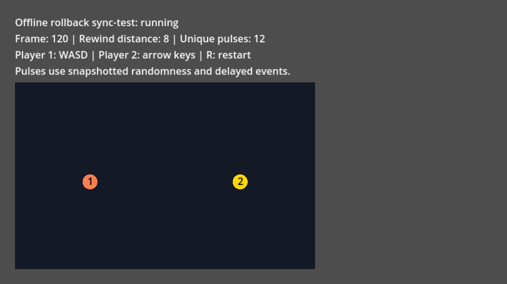

# Offline rollback example

Run a two-player sync-test using the shipped GDScript addon and Godot 4.3 or newer.
No Rust, native extension, network service, test runner, or oracle is required.
This example tests local rollback. Online play and browser networking remain planned.

## Run from this repository

Open `project.godot` in Godot, open
[`examples/offline/offline.tscn`](../examples/offline/offline.tscn), then press F6.
Alternatively, run:

```sh
godot --path . res://examples/offline/offline.tscn
```

Move player 1 with WASD and player 2 with the arrow keys. Press R to restart.
The arena scales to the window. The status displays the current frame,
rewind distance, and number of unique color pulses.
A stopped session displays its error code and failure frame.
Temporary `BUSY` ticks retry after active expert work releases ownership; they do not stop the match.



## Install in a clean project

1. Create a Godot 4.3 or newer project using the Compatibility renderer.
2. Copy `addons/fortress_rollback` into the project's `addons` directory.
3. Copy `examples/offline` into the project's `examples` directory.
4. Set **Physics > Common > Physics Ticks Per Second** to **60**.
5. Open `examples/offline/offline.tscn` and press F6.

Keep the directory names: the scene uses explicit `res://` preloads.
The addon does not need an editor plugin or autoload.
Set the scene as the main scene to run it with F5 or export it.

## State and callbacks

[`simulation.gd`](../examples/offline/simulation.gd) is the shared game simulation.
It advances integer positions by exactly one tick per `simulate_frame` callback.
Input is one byte per player: left=1, right=2, up=4, down=8.
Opposite directions cancel, and all 16 button combinations are valid.

The seeded integer PRNG advances in ascending player order each tick.
Every 20 frames, each player schedules a color pulse three frames ahead.
The complete 136-byte snapshot uses signed 64-bit little-endian fields:
format version, next frame, PRNG state, then both players' positions,
pending pulse frames/colors, and latest pulse IDs/frames/colors.
All values are integers; each player always has at most one pending pulse.
The driver checksum uses four explicit FNV-1a 32-bit lanes, totaling 16 bytes.
The session also compares canonical snapshot bytes.

The scene configures `max_snapshot_bytes` and the required storage budget explicitly.
Its `FortressDriver` consumes ordered save, load, and simulate requests synchronously.
The game checks callback frames, input width, and bounded reader/writer results.
It calls `reader.is_complete()` before applying restored fields, rejecting
trailing bytes without changing game state.
It validates every snapshot field before applying state, including colors,
positions, event IDs, random state, and pending-event frame ranges.
Corrupt or truncated snapshots fail without changing simulation state.
Positive check distance repeatedly restores eight frames and verifies resimulation.
Check distance zero would disable these save/load checks.

`current_frame` is the next input frame: saving frame F stores `S(F)`;
simulating input F produces `S(F+1)`. Sample both local players using that frame.
The production session checks frame exhaustion. The example encodes snapshot
frame fields as fixed-width integers, without floats or JSON conversion.
The wall-clock microseconds supplied to `step` only drive session polling.
The simulation never reads them or the engine's delta time.

Every player is local in sync-test, so this scene does not encounter prediction stalls.
In external-input sessions, retain the same local sample bytes while stalled.
Retry at the unchanged `current_frame`; identical samples are idempotent.
Replacing them with newly polled keys would produce `INPUT_ALREADY_SUBMITTED`.
See the [session guide](session.md) before adapting this loop to remote input.

## Presentation after rollback

Simulation callbacks perform no rendering, audio, file writes, or network effects.
After a successful driver step, presentation reads the final corrected state.
The scene interpolates between previous and current completed integer positions.
Interpolation uses floats only for drawing; it never feeds back into simulation.

Pulse IDs derive from their simulation frame and player slot.
[`presentation.gd`](../examples/offline/presentation.gd) keeps two last-seen IDs
and counts a pulse once, even when the simulation repeats its callback.
The scene draws a short pulse ring from the latest corrected event frame.
It does not spawn permanent effects during speculative simulation.
Both pending pulses and latest event records are snapshotted.

This ledger is a cosmetic demonstration for a session with immutable local inputs.
For future online play, prediction can introduce and later remove an event.
A stable ID alone cannot undo audio, achievements, payments, or network messages.
Keep speculative visuals reversible, and emit irreversible effects only when
their simulation frame is confirmed and completed. Treat rollback reconciliation
as presentation work after the entire driver batch, including recovery-only stalls.

## Verify the example

Run the deterministic regression suite without Rust:

```sh
make test-focus SUITE=res://tests/unit/test_offline_example.gd
```

The suite compares all 160 corrected snapshots against uninterrupted simulation,
including pending pulses and history wraps. It verifies exactly 16 unique pulses
and repeated reconciliation without duplicates. Deliberately omitting PRNG state
or pending pulses must terminate through the production sync-test desync check.
The runner executes each case twice and repeats it in fresh processes.
