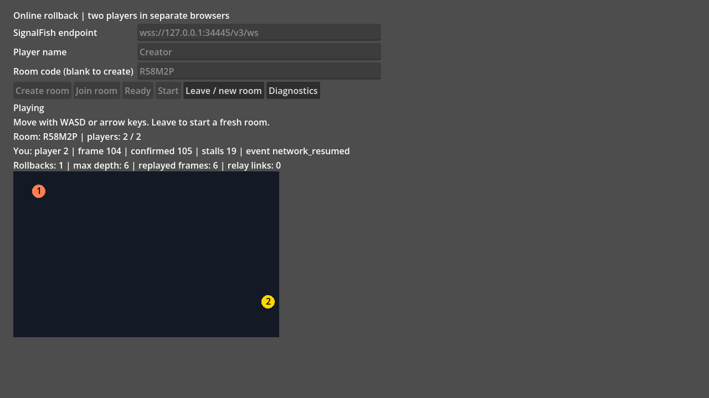
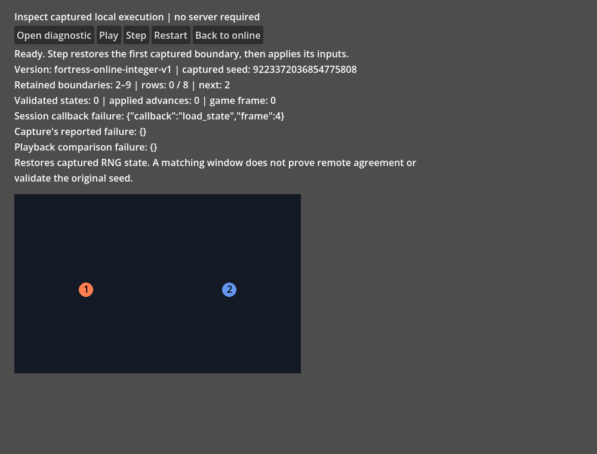
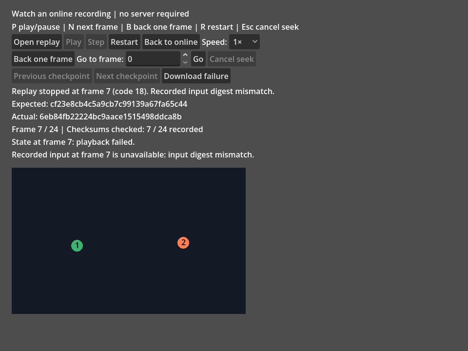

# Online two-player example

Open `examples/online/online.tscn` to play the existing integer movement game
with someone in another browser. The scene uses real SignalFish signaling,
WebRTC bytes and the bounded binary relay fallback coordinator. WASD or arrow
keys control your own numbered player. The sorted full player UUID roster
assigns numbers, so the room creator is not necessarily player one.



The SignalFish SDK is optional. Without it the scene opens and explains how to
install it; the root addon and other examples remain runnable. This example
requires an initial WebRTC mesh plan with relay support available in standby.
An initial relay-only plan is reported as unsupported. It keeps the same
rollback session when an established direct link falls back to relay.

## Install and run

Start from this checkout, with Python 3 and a Godot **4.3** or **4.7.2** executable.
Install that editor's matching standard export templates using **Editor > Manage Export Templates**.
Set `GODOT` to its absolute executable path. Repeat the flow with each editor when checking both pins.
The following commands use a new project and a separate tools directory:

```sh
GODOT=/absolute/path/to/godot
EXAMPLE_DIR=$(mktemp -d)
TOOLS_DIR=$(mktemp -d)
python3 scripts/reference/online_install.py --project "$EXAMPLE_DIR"
"$GODOT" --headless --path "$EXAMPLE_DIR" --editor --quit
"$GODOT" --path "$EXAMPLE_DIR"
```

The installer copies only the runtime addon, online/offline scenes and their dependencies,
licenses, a minimal project, and a Web export preset. It does not copy this checkout's
`.godot`, `.cache`, tests, server, compiler, scripts or native extensions. The project uses
60 physics ticks per second, the Compatibility renderer and a Web export without threads.
No plugin or autoload needs activation.

Before installing the SDK, press **Create room**. The scene must explain that SignalFish
is missing and name this guide. The [offline scene](offline-example.md) still runs:

```sh
"$GODOT" --path "$EXAMPLE_DIR" res://examples/offline/offline.tscn
```

Close the editor/game before adding files. Download and verify the optional SDK,
then install only its addon directory, including its license:

```sh
curl -fL https://codeload.github.com/Ambiguous-Interactive/signal-fish-client-godot/tar.gz/db7d30f228d8d564adcb2eb38d5983bf6b9877ac -o "$TOOLS_DIR/sdk.tar.gz"
echo "0854f8c778a118defe95bd8887e227c8bc8c194c54d2e501c6d74094fa43ec12  $TOOLS_DIR/sdk.tar.gz" | sha256sum -c -
tar -xzf "$TOOLS_DIR/sdk.tar.gz" -C "$TOOLS_DIR"
python3 scripts/reference/online_install.py --project "$EXAMPLE_DIR" \
  --sdk "$TOOLS_DIR/signal-fish-client-godot-db7d30f228d8d564adcb2eb38d5983bf6b9877ac"
"$GODOT" --headless --path "$EXAMPLE_DIR" --editor --quit
```

The pinned SDK needs no editor plugin or autoload. Use an existing compatible SignalFish
v3 deployment, or build the pinned local server below. Rust is needed only to build that
separate server; the installed Godot project needs neither Rust nor native WebRTC extensions.
Local browser ICE uses no STUN/TURN server and proves no public-network connectivity.

```sh
curl -fL https://codeload.github.com/Ambiguous-Interactive/signal-fish-server/tar.gz/9c2fb8fa635a69241b8ccf38be651d561fef7434 -o "$TOOLS_DIR/server.tar.gz"
echo "1c618785dd93e1a69f27687f1f8f75fbfb15e49f3a3a0f130aa3ee17af40a076  $TOOLS_DIR/server.tar.gz" | sha256sum -c -
tar -xzf "$TOOLS_DIR/server.tar.gz" -C "$TOOLS_DIR"
SERVER_SOURCE="$TOOLS_DIR/signal-fish-server-9c2fb8fa635a69241b8ccf38be651d561fef7434"
rustup toolchain install 1.94.0 --profile minimal
cargo +1.94.0 build --manifest-path "$SERVER_SOURCE/Cargo.toml" --locked --no-default-features \
  --bin signal-fish-server --target-dir "$TOOLS_DIR/server-target"
python3 scripts/reference/online_install.py --server-source "$SERVER_SOURCE" --port 8080 > "$TOOLS_DIR/server.json"
SIGNAL_FISH_CONFIG_JSON="$(cat "$TOOLS_DIR/server.json")" "$TOOLS_DIR/server-target/debug/signal-fish-server"
```

Keep that server running in its terminal. The generated configuration sets the application's
ID to `fortress-live-webrtc`, selects mesh/WebRTC, allows binary relay and removes external
ICE servers. The scene requests MessagePack binary game data. If the build needs system
packages, see the [server prerequisites](reference/README.md#setup-and-reproduction).

In another terminal with the same `GODOT`, `EXAMPLE_DIR` and `TOOLS_DIR` values,
export the production scene and generate a local development certificate:

```sh
EXPORT_DIR="$TOOLS_DIR/web"
mkdir -p "$EXPORT_DIR"
"$GODOT" --headless --path "$EXAMPLE_DIR" --export-release Web "$EXPORT_DIR/index.html"
openssl req -x509 -newkey rsa:2048 -nodes -days 1 -subj /CN=localhost \
  -addext subjectAltName=IP:127.0.0.1 -keyout "$TOOLS_DIR/localhost.key" -out "$TOOLS_DIR/localhost.crt"
node scripts/reference/browser/online_host.cjs "$EXPORT_DIR" ws://127.0.0.1:8080/v3/ws \
  "$TOOLS_DIR/localhost.crt" "$TOOLS_DIR/localhost.key" 8443
```

The development host needs Node.js, but has no npm dependencies. It serves the correct
WebAssembly MIME type and proxies WSS to the separate loopback server. Open
`https://127.0.0.1:8443/index.html` in two Chromium windows. Accept your own generated
local certificate in each browser profile. Use `wss://127.0.0.1:8443/v3/ws` in both clients.
A secure page, including Chromium's localhost secure context, requires WSS.
For public hosting, replace this loopback helper with trusted HTTPS/WSS hosting and
configure ICE/STUN/TURN for your deployment. Native editor networking needs a separately
installed WebRTC implementation.

1. In the first browser, enter the WebSocket endpoint and player name, then
   press **Create room**. Copy the displayed room code.
2. In the second browser, enter the same endpoint, a player name and that code,
   then press **Join room**. The room is limited to two players.
3. Both players press **Ready**. The creator presses **Start** once both are
   ready. Network synchronization must complete before movement advances.
   Click outside text fields if a field still has keyboard focus.
4. Move with WASD or the arrow keys. The display reports your player number,
   frame, confirmed frame, input delay, stalls, latest event and active relay links.
5. On a laggy connection, press **=** to raise your input delay by one frame.
   Moves then take effect a frame later, with fewer corrections. Raises cannot be undone in this match.
   When the measured connection needs more delay, the display shows a suggested delay.
   Press **R** to apply it.

## Diagnostics

The display shows completed rollback count, maximum restore depth, replayed frames and
active relay links. Press **Diagnostics** to download `fortress-diagnostics.json` in a browser
or copy JSON to the clipboard natively. Download before leaving a failed match.

The report includes frame/confirmation, completed-work counters, per-link backlog/RTT,
engine version and retained terminal causes. It excludes names, room/player/connection IDs,
SDK configuration and tokens. It uses no browser storage.

Game payloads stay excluded by default. To collect canonical evidence, select
**Include game state and inputs in diagnostics** before pressing **Ready**.
The choice freezes for that match. It retains at most 120 frames of local saved
state and applied inputs, with the game's seed and version. The first checksum
mismatch freezes that window; download it before leaving the failed match.
Review the game bytes before sharing. The checkbox affects only local diagnostics,
so the other player can keep capture disabled. New rooms use the checkbox's current
choice when you press Ready. See the [trace contract](peer-lifecycle.md#opt-in-canonical-divergence-evidence)
for payload bounds and missing-history limits.
A checksum mismatch includes both checksum hex strings and the first mismatching frame.

## Inspect a diagnostic file

After leaving the room, press **Inspect diagnostic file** and open a downloaded
`fortress-diagnostics.json`. The viewer restores the captured local state, applies
the retained inputs, and compares each available saved boundary. Play, pause, step
or restart without a server. It shows the capture's reported failure separately
from any playback difference. See [diagnostic viewer](diagnostic-viewer.md) for
window limits and interpretation.



## Record and download a replay

Select **Record replay** before pressing **Ready** to retain the first 36,000 confirmed
gameplay frames: ten minutes at 60 Hz. Recording defaults off and freezes at Ready.
It works independently of diagnostic payload capture and includes both players' confirmed
inputs, available checksums, the fixed game seed and game version. It excludes names,
room identifiers, SDK configuration and tokens. Review game inputs before sharing.

Press **Download replay** once confirmed gameplay is available. Browsers download
`fortress-online.frrp`; native runs save `user://fortress-online.frrp`, replacing the
previous export, and display the full saved path or an error. Export remains available
after a failed match and after **Leave / new room**. Save it before creating or joining
the next room, which replaces the old match. At the recording limit,
gameplay continues while the recorded prefix stops growing; later exports contain that
same prefix.

For a final-state checksum, press **Finish replay** before leaving. This stops your local
simulation, keeps transport delivery active, and applies pending corrections without another
input frame. Once the status says the final state was captured, download the replay and leave.
The other player can continue sending while your final inputs settle; finishing is local,
not an agreement to end both players at the same frame.

Controller calls during a game callback, completion notification or manual request preserve the active operation.
Tick and clock service skip reentrant work; room setup, delay changes and replay finishing return BUSY.
Call them again after the operation completes. Busy service does not commit a new clock or stop the match.
Explicit leave and failure cleanup remain available. Leaving cancels outstanding game work immediately;
SDK nodes still executing a callback are released after it returns. Canceled startup cannot reopen the room.

A successful capture exports FRRP v6 and checks the state after the last recorded input.
Finishing before the first input can export the captured initial state with zero input frames.
Waiting for confirmation or drop repair does not certify a predicted boundary. If the
connection fails first, download the available v5 history without final-state evidence.
After the recording cap falls behind live gameplay, a new capture is unavailable; the
recorded prefix still downloads with its historical checksum coverage. There is no
automatic extra SAVE on ordinary ticks or downloads.

After leaving the room, press **Watch replay**, then **Open replay** and choose your
`fortress-online.frrp` or `fortress-spectator.frrp` file. Native builds use a file dialog; browsers use a local
file chooser without uploading the file or using browser storage. Playback needs
no SDK or server. Press **Play / Pause**, **Step**, or **Restart** to inspect the game.
Keyboard controls: **P** plays or pauses, **N** steps forward, **B** steps backward,
**R** restarts, and **Esc** cancels a seek. Shortcuts preserve text entry and file chooser input; modified and held-key repeats are ignored.
Use **Speed** to watch at ¼×, ½×, 1×, 2× or 4×. Every recorded frame and available checksum
is still processed; fast playback advances at most four frames per tick. **Step** always
advances exactly one frame and finishes paused. Step and Pause validate the displayed
state boundary immediately, including sparse recorded checksums, without consuming its input.
Pause, stepping, seeking and speed changes clear any partial
slow-motion frame; restart and new imports keep your selected speed.
Press **Back one frame** to inspect the preceding state, including after completion or a checksum failure.
It pauses playback and uses the same bounded navigation as **Go**; **Cancel seek** can interrupt a long restore.
Use **Previous input change** and **Next input change** to inspect when either player's
recorded controls or confirmed/disconnected status changes. Each action selects a boundary
strictly before or after the displayed frame and finishes paused. The first input starts
at frame zero; the final state has no input. These actions use the same bounded,
verified navigation as **Go** and cannot skip corrupt history. Failed playback requires
**Restart** or an explicit **Go** before input-change navigation becomes available again.
Use **Previous recorded checksum** and **Next recorded checksum** to find the recording's
state verification boundaries, including a recorded final state. These destinations are
available before playback visits them, even when checksums are sparse. Each action
validates the required input history and selected state, then finishes paused. It stops
at corrupt input or a mismatching checksum; finding a destination alone claims no validation.
A recording without state checksums has no such destinations. Failed playback requires
**Restart** or an explicit **Go** before these controls become available again.
Use **Previous checkpoint** and **Next checkpoint** to jump between retained, validated five-second boundaries.
When a recording includes a validated final-state checksum, its ending is also
retained within the checkpoint budget. **Next checkpoint** can return to that
ending after backward inspection, even between five-second boundaries.
These controls become available as playback builds its cache. They finish paused and cannot skip a playback failure.
Enter a frame number and press **Go** to navigate forward or backward. Navigation
uses bounded in-memory checkpoints from previously validated playback, then replays the
remaining inputs and checksums. A first visit still validates the full preceding history. Each UI tick processes at most 120 frames, and **Cancel seek**
pauses at the last validated boundary. Navigation finishes paused at the requested frame.
Pausing at a seek destination validates that state through the same bounded snapshot callback as playback.
The display shows the current frame and stops at the first failed recorded checksum.
The selected-state line separately identifies a matching, unchecked or absent recorded state checksum.
The next-input line shows each player's recorded directions and confirmed or disconnected status
at the displayed frame. Combined directions remain visible, including opposing buttons.
It checks the row's stored input digest before showing controls, and hides mismatching values.
The final state has no next input; moving backward restores the selected row's display.
Advancing an input does not check its resulting state until you pause, step or finish a seek.
Input digests and cached snapshots do not count as recorded state checksums.
**Checksums checked** reports distinct matching state boundaries, the number of recorded checksums, and the recording length.
Repeated navigation does not count the same boundary twice; restart begins a fresh verification count.
Playback controls refuse changes while a game callback or manual replay request is active.
Restarting or opening another recording terminates the previous player, including retained handles.
Completion identifies whether the final state matched a recorded checksum. Historical recordings explicitly report
that their final state has no recorded checksum, even when every earlier checksum matched.
A recording with no checksums plays its inputs but explicitly reports that playback could not be verified.
Checksum failures show both the expected and actual values as hexadecimal strings, including failures at a seek target.
After a failure, press **Download failure** to retain `fortress-replay-failure.json`.
Browsers download the file; native runs save it under `user://`, replacing the previous report, and show its full path or an error.
The report includes the original replay file's SHA-256, recording and playback engine versions,
failure frame/code, failed request kind, comparison kind and hashes, checksum counts and the observed game state.
The message and report distinguish input integrity failures from state or restored-checkpoint mismatches.
Callback errors also name whether saving state, loading state or simulating input failed.
Keep the original `.frrp` with it: the report excludes the input history and cannot replay the match by itself.
The observed state is diagnostic evidence, not a claim that the failed boundary passed validation.
Reports are bounded to 16 KiB. Restart clears failure export; a rejected import retains the previous failure.
This report has a separate versioned schema and is not an input to **Inspect diagnostic file**.


**Back to online** returns to room setup.

The viewer accepts complete online integer recordings with seed 1701 and explicitly
identified local spectator-example recordings. Both use two players and one-byte
inputs, up to 36,000 frames. The selected game determines its initial state,
state callbacks and control names: spectator input shows Fire instead of Up. The file-size limit includes
every checksum and the maximum metadata header for that full ten-minute recording.
Other games, unknown game/addon/upstream versions, missing-input rows and invalid button bytes are rejected.
Recordings from the original Fortress baseline remain compatible after dependency-only baseline refreshes.
A failed import keeps the previous recording. Engine versions may differ; available
recorded checksums still must match. Checksums are not an authenticity guarantee.
For other games, use `FortressReplay.decode()` and `FortressReplayPlayer` with your
own initial state; see [replays](integration.md#record-and-replay-a-match).

## Leave and restart

**Leave / new room** detaches the fallback coordinator, direct and relay
adapters, membership adapter and SDK objects. To restart, both players leave;
the creator creates a fresh room and shares its new code. Join that fresh room,
ready again and start again. The scene does not restart inside the old room.

A connection failure, membership change, reconnect or terminal rollback error
stops the old game, detaches its transport queues and WebRTC mesh, and closes its
SignalFish connection. A failure during an active send finishes queue cleanup
after the send unwinds. Failed ticks service the SDK close handshake without
advancing gameplay. The first failure message remains visible until Leave;
then establish a fresh room. Automatic SDK reconnect is disabled.
Rejoining a server room cannot recover rollback
history or authorize a new session over old packet queues.

The application match identity is a domain-separated 16-byte SHA-256 prefix
of the fresh room UUID, sorted full player UUIDs and fixed game/config revision.
It is separate from the raw room UUID and each random transport-incarnation ID.
A new room changes that identity. The simulation uses the existing seeded,
fully snapshotted integer game; host clock and transport entropy never enter its
state. Keyboard input is retained across prediction or queue stalls until that
original frame is accepted.

## Suspension and expiry

The caller polls elapsed monotonic protocol time before retrying retained output
or receiving buffered gameplay. Running games also service their protocol clock
before SDK callbacks can end the room. Refused output never freezes that clock.
After a brief scheduling pause, a live session can resume through prediction
repair without replacing its identity or input history. Each caller tick advances
at most one new simulation frame; elapsed seconds never become invented inputs.
Godot also bounds physics catch-up to eight ticks per rendered frame by default.
Each of the eight service rounds permits one additional protocol poll after
draining diagnostic pressure, before receiving buffered bytes. Freeing a full
event or trace bank must not allow a completion reply to overtake expiry.
The service batch stops early once the transport is idle: a route that neither
moved bytes nor holds queued work has nothing left to do this frame, so the
remaining budget belongs to the game and the browser. A refused packet still
counts as traffic, so valid bytes queued behind it are never left unread.

The browser witness publishes the host's service cadence with the room state: the
largest wall-clock gap between consecutive service turns, the nominal fixed-tick
turns that pause covered, the transport time it spans and the longest wait from a
submitted local frame to its confirmed receipt. A starved host and a transport
that lost bytes therefore look different in the same room. The counters describe
one room and restart with the next one. The summary stays out of the canonical
game state, the retained diagnostics and any recording.

The running protocol expires after more than two seconds without an accepted
remote packet. Initial rollback synchronization has a 30-second application
deadline. Exact deadline boundaries remain eligible. A due handshake timeout
remains observable when token or outgoing-packet capacity prevents another retry.
An expired game stops before buffered packets can refresh liveness. Leave and
create a fresh room; returning to the tab cannot resurrect old history.

## Verification

The existing browser launcher now starts with the same `online_install.py` command above.
It uses a new project and empty engine configuration, cache and data directories for each
engine. Before installing the SDK, it checks the actual missing-SDK status label and runs
24 offline frames against an independent canonical replay. It then installs the optional
SDK, imports and exports the unmodified production scene using the documented preset.
Only afterward does it add a development observer for the five-room browser flow below.
The observer records original submitted inputs and corrected state; it does not replace
simulation or transport implementation. The fixture uses the same HTTPS/WSS host as the
manual commands. Its owned server uses the same generated configuration with higher
traffic ceilings for repeated fault scenarios.

Run the regression after the [source-bound server build](signalfish-relay.md#reproduce-native-server-delivery):

```sh
python3 scripts/reference/signalfish_webrtc_probe.py --online-example \
  --server .cache/reference/results/signalfish-server-build/target/debug/signal-fish-server \
  --server-source .cache/reference/signal-fish-server-9c2fb8fa635a69241b8ccf38be651d561fef7434 \
  --build-receipt .cache/reference/results/signalfish-server-build/build-receipt.json \
  --output .cache/reference/results/online-example
```

Both pinned engines run by default. Receipts record the exact install/export commands,
engine versions, source/tool hashes, clean installation inventories, offline canonical
state, browser input/rollback evidence and rendered `VERSION-online.png` screenshots.
CI runs the same command for Godot **4.3** and **4.7.2** with pinned Playwright **1.56.1**
and Chromium **141.0.7390.37** on Linux. Firefox, WebKit, mixed browsers, native WebRTC,
public hosting and WAN/NAT/TURN remain unverified release gates under
[browser coverage #39](https://github.com/Ambiguous-Interactive/fortress-rollback-godot/issues/39).
The harness can reuse verified tool archives; none of that development cache enters the
installed project or its fresh engine user directories.

For each room, the witness holds bounded original input packets until both current
game instances have successfully simulated a predicted remote input. Only then does
it release the original keyboard inputs. Receipts bind this barrier to the room,
session and game lifetime; stale callbacks or channels cannot supply the proof.
Both peers must still restore, confirm and match the independent canonical state.


`tests/unit/test_online_example.gd` covers optional SDK scene loading, room
identity validation, real two-peer protocol startup over SDK transport doubles,
prediction stalls and held input recovery, caller-owned refusal retries and
terminal callback ordering. It runs through the ordinary headless test runner
with deterministic and fresh-process repeats. These injected tests establish
application behavior; exported browser evidence is a separate verification gate.

`tests/unit/test_online_startup.gd` delays one peer's final handshake reply
behind original gameplay on both direct and relay paths. Later keys change;
both peers must recover the exact earlier bytes. Valid early traffic is inert
until synchronization completes, and malformed traffic remains rejected.

`tests/unit/test_online_lifecycle.gd` covers exact expiry boundaries, retained
send pressure, saturated handshake tokens and bounded short-suspension recovery.
The browser witness pauses both actual Chromium page threads through acknowledged
CDP debugger commands. It measures host/protocol clock gaps, corrected original-input
prefixes after a short pause, and actual frozen frames after an overdue pause.
This controlled execution pause does not establish hidden-tab policies, operating
system sleep or Firefox/WebKit behavior.

The same exported witness verifies that overdue games close their signaling
sockets before Leave. It then cuts both actual signaling socket pairs during
another active game, requires frozen terminal frames and physical connection
cleanup before Leave, and plays a fresh room with a new rollback identity.
A separate fourth-room stage kills the owned server process during gameplay,
with retained relay sends and one delayed original input per peer. It verifies
the process exit, frozen failed frontiers, unchanged recovery messages and full
connection cleanup before Leave. The same binary/configuration restarts on the
same endpoint with a different live process handle and bounded readiness checks.
Both players explicitly Leave, then play a fifth room with fresh room and rollback
identities. Original old-room bytes sent over the new direct channels are counted
and discarded; corrected prefixes still match the new original keyboard inputs.
The witness also invokes captured old SDK info, room, ready and error callbacks
after the fifth game starts. Connection revisions fence those callbacks; they
cannot change the fresh game, readiness, protocol configuration or message.

This proves explicit fresh-room recovery after socket outage and server-process
death. It does not reconnect or restore an existing match. Restoring ICE, SDK
replans, WAN/NAT/TURN and the full browser matrix remain separate acceptance
cases under [the lifecycle issue](https://github.com/Ambiguous-Interactive/fortress-rollback-godot/issues/38).
