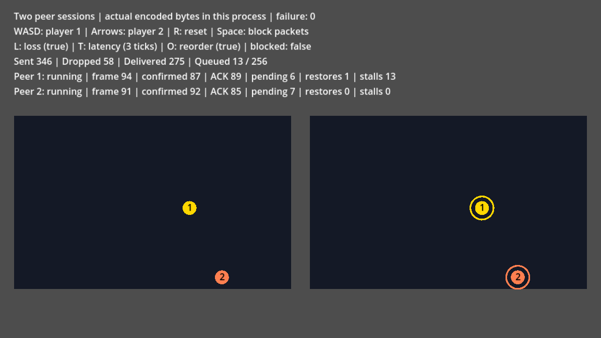

# Two peer sessions with packet faults

Open `examples/peer/peer.tscn` in Godot 4.3 or later and run the scene (F6), or:

```sh
godot --path . examples/peer/peer.tscn
```

Two independent sessions simulate the same arena. Each owns one local player
and predicts the other player. Their transport routes actual encoded handshake,
input and ACK bytes in one process. This example does not connect computers.
The shipped addon and this scene require no Rust or development oracle.

| Control | Action |
| --- | --- |
| WASD | Move player 1 |
| Arrow keys | Move player 2 |
| L | Toggle dropping every seventh packet |
| T | Toggle latency between 3 and 12 physics ticks |
| O | Toggle packet reordering |
| Space | Block outgoing packets; press again before timeout to recover |
| X | Change one peer's game rules to demonstrate a desync |
| 1 / 2 | Raise peer 1's or peer 2's input delay by one frame |
| F / G | Apply the measured delay suggestion for peer 1 or peer 2 |
| P | Pause or resume both peers and packet delivery |
| N | Service one ordinary packet/game tick while paused |
| R | Reset sessions, snapshots, packets and counters |

Visible buttons provide the same packet faults, wrong-game-rules, delay, inspection and reset actions.
Their labels show the current fault settings. They leave keyboard movement and shortcuts available.
Fault controls are available during startup; delay and wrong-game-rules actions wait for both peers to run.
All controls wait while either peer owns game work. A stopped match keeps only reset available.

Number-row shortcuts use physical key positions, so 1/2 work without Shift on AZERTY layouts.



The left arena shows peer 1's corrected state; the right shows peer 2's.
The displayed frame and confirmation frontier can differ during prediction.
ACK is the newest local input acknowledged by the other endpoint. Pending
counts retained unacknowledged frames. Restores count successful snapshot loads;
stalls count physics ticks blocked by prediction or network backpressure.
The timing line shows RTT, frame advantage, interruption and the latest event.
Press Space briefly to observe interruption and resumed progress. A block lasting
over two seconds terminates the fixed-membership sessions. Press X to create a
real game checksum mismatch; the event identifies its saved frame. Press R to
start new sessions after a timeout or desync.

The transport holds at most 256 packets and drops new packets when full.
Each physics tick injects exactly 16667 microseconds into protocol timers;
latency and reordering use that clock. Simulation advances in whole frames
and never reads clocks, keyboard state or transport settings. A sample already
submitted for a stalled frame remains fixed until that frame advances; new
keyboard state applies to the next sample. The two-frame input delay provides
neutral startup frames. Press 1 or 2 to raise one peer's delay mid-match; the delay line shows it,
and both arenas keep agreeing because the added frames reach the other peer as ordinary input.

The example reuses the offline integer simulation, complete snapshots and
presentation ledger. It draws reversible pulses from corrected state after
successful steps. Reset preserves the selected latency/loss/reorder settings
and releases any active packet block. Retained handles to the old peers stop permanently.
An invalid replacement preserves the current match. While either peer owns a callback,
completion notification or expert request, reset and delay changes return BUSY;
nested ticks and desync injection leave the match unchanged.
`Match.tick()` returns an input-endpoint service code, or a session code when
local input conflicts with an expert-staged sample. Invalid buttons and fault
settings return `I.Code.INVALID_ARGUMENT`; active ownership returns `I.Code.BUSY`.
These rejected attempts preserve clocks, queued packets, held samples and the
playable match. Correct the controls and retry when `failure` remains zero.
The return-code domains overlap: `Types.Code.INPUT_ALREADY_SUBMITTED` and
`I.Code.CONFLICT` both equal 10. Check `failure` before classifying a nonzero
return as retryable; a match with nonzero `failure` must be reset. Actual service failures
retain their first code. Any terminal fixed member stops the whole match,
retires the other peer and reports `I.Code.INPUT_FAILED` unless an earlier
service failure already supplies the cause. Per-peer status retains the detailed
terminal reasons and drained events remain visible in the example observations.
A stalled frame continues using its original held buttons.

The headless suite `tests/unit/test_peer_example.gd` exercises actual loss,
reordering, a prediction stall, partition healing, full canonical state
agreement, reset, invalid controls and scene loading. Real WebRTC transport,
connection discovery and membership repair remain separate work.
`tests/unit/test_peer_example_lifecycle.gd` exercises visible interruption,
short-partition recovery, terminal long partitions, restart and real game desync.
`tests/unit/test_peer_example_ownership.gd` covers retained old handles, rejected
replacement and shared callback/expert ownership of the example controls.
`tests/unit/test_peer_scene_controls.gd` checks pointer/keyboard parity, startup and stopped
readiness, and safe retry after shared expert and completion ownership releases.

Delay shortcuts and their prompt are available only while both peer sessions run.
Reset remains available after a match stops; retained observations still describe the previous gameplay.

Match shortcuts ignore Ctrl, Alt, Command and Shift combinations, released keys and held-key repeats.

Use Pause (P) to inspect a packet fault without advancing either peer or the
injected delivery clock. Step tick (N) services one ordinary tick while paused,
including packet delivery, retries and an attempted frame for each peer.
Prediction can stall without advancing; the held input stays unchanged until
that frame succeeds. Reset resumes a fresh match. Active callbacks or expert
requests disable inspection controls, and a stopped member ends the paused match.

Losing application focus pauses both peers and the injected packet clock.
Returning to the window keeps them paused; use
Resume (P) when ready. A focus change during a callback lets that accepted tick
finish and pauses before the next one. Reset starts a running match.

Measured delay buttons show each peer's latest suggested delay after sustained
latency. F and G accept those suggestions; the scene never applies them automatically.
A raise cannot be undone in the current match. Offers expire after 600 simulated
frames, or when the current delay already covers them. Pointer and keyboard
acceptance wait for both peers to run and for active game work to finish.
Reset clears old offers. The match retains only the latest recommendation per
peer, so unattended observations stay bounded.
