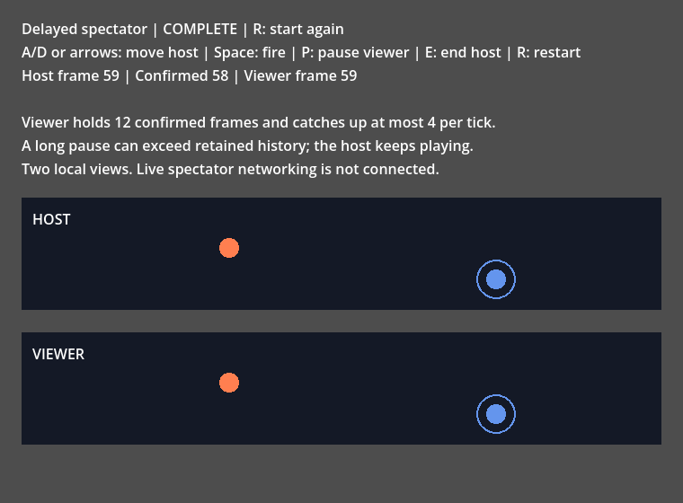

# Play a confirmed host stream

`FortressSpectatorSession` plays one trusted host's complete confirmed input rows.
It uses the same ordered expert requests and `FortressDriver` game callbacks as
player sessions. Spectators contribute no input, prediction or confirmation to
the host. The playback API and optional byte envelope are transport-independent; live SignalFish
spectator routing and network handshake remain under [#47](https://github.com/Ambiguous-Interactive/fortress-rollback-godot/issues/47).

## Try the local example

```sh
godot --path . res://examples/spectator/spectator.tscn
```

The upper board is a playable host with delayed remote input and actual rollback.
The lower board follows its corrected input history, twelve confirmed frames behind.
Move with A/D or arrows and fire with Space. Press P to pause only the viewer;
resume to catch up at most four frames per physics tick. Press N to pause and inspect
one confirmed viewer frame at a time. Each press advances at most one frame and still
respects the viewing delay; it waits when confirmed inputs are unavailable.
The host continues playing during inspection. E stops the host at its current
frame, waits for outstanding actual inputs, repairs its final state and sends a clean end.
A paused viewer can resume or press N through the final tail to display that exact final state.
After the last frame, press N once more to report completion. R starts a fresh game.

A long viewer pause can exhaust retained host history. The viewer then stops
with `HISTORY_UNAVAILABLE`; the host keeps playing. The example encodes and receives spectator byte packets
in the same process, with an injected ten-second host deadline. It requires no server,
SDK or native extension. The example negotiates the envelope version before its
first row and sends keepalives on ticks without accepted rows,
including initial prediction and viewer backpressure.



## Configure the viewer

Start the game from the host's original initial state. The player count, input
width, neutral input, seed and game rules must match the host. Later admission
requires a separate agreed state-transfer contract, which this API does not supply.

```gdscript
const Config = preload("res://addons/fortress_rollback/core/config.gd")
const Spectator = preload("res://addons/fortress_rollback/core/spectator_session.gd")
const Driver = preload("res://addons/fortress_rollback/core/driver.gd")

var config: Config = Config.new()
config.spectator = true
config.sync_test = false
config.local_players = PackedInt32Array()
config.check_distance = 0
config.max_prediction_frames = 0
config.history_slots = 1
config.max_snapshot_bytes = Game.SNAPSHOT_BYTES
config.storage_budget_bytes = config.required_storage_bytes()
var viewer: Spectator = Spectator.new()
var code: int = viewer.configure(config)
# Continue only when code == FortressSessionTypes.Code.OK.
code = viewer.set_playback(12, 4, 4)
var driver: Driver = Driver.new(viewer, Game.new())
```

The configuration requires zero input delay, zero prediction and no local players.
`queue_capacity` bounds both the per-player core queues and the extra host row
ring. The storage reservation includes both payloads and their tags; engine object
metadata remains bounded overhead, as with ordinary sessions.

`set_playback(stream_delay, max_frames_behind, catchup_speed)` holds playback
behind the highest contiguous host frame. The delay must be smaller than the
queue capacity; catch-up speed must be positive and at most that capacity.
When more than `max_frames_behind` playable frames await, `recommended_steps()`
suggests up to `catchup_speed` single-frame steps. Otherwise it suggests one.
No available frame returns zero while the host stream remains open. Gaps never
move the contiguous frontier. After a clean end, one final recommended call
publishes termination without advancing the game.
`playback_policy()` returns the current `[stream_delay, max_frames_behind, catchup_speed]`.

Call `driver.step(now_us, empty_local_inputs)` that many times using an explicitly
typed `Array[Driver.LocalInput]`. Alternatively, consume `begin_advance()` and
`complete_request()` manually. Each batch uses the shared session engine and
advances one frame, except the final termination call. `begin_advance()` enforces stream delay even if the caller
ignores the recommendation. The catch-up rate stays the caller's: take the reported
number of steps per service cycle. Protocol time must remain monotonic.
Playback never guesses a row. If the retained host row for the current frame is gone,
the advance is refused with `HISTORY_UNAVAILABLE` and no game callback runs.

## Deliver confirmed rows

The caller must authenticate the host, bind packets to the correct game lifetime,
and agree configuration before calling `receive_host_frame(frame, inputs)`.
The method takes one `Array[PackedByteArray]` in stable player order, copies it,
and validates every player's width before changing the buffer.

| Result | Meaning |
| --- | --- |
| `OK` | Owned row accepted, or identical retained duplicate |
| `INVALID_CONFIGURATION` | Row does not contain exactly the configured players |
| `INPUT_WIDTH` | A player's input has the wrong byte width |
| `INVALID_FRAME` | Negative, exhausted or overwritten old frame |
| `INPUT_ALREADY_SUBMITTED` | Conflicting duplicate; original row remains unchanged |
| `NETWORK_BACKPRESSURE` | Frame is beyond the bounded future window; retain and retry after playback |
| `BUSY` | A request batch or game callback is active; retry after completion |
| `TERMINATED` | Host stream ended or the session was terminated |

Rows may arrive out of order within the current bounded window. No partial row
or prediction is simulated. Rejected rows leave the accepted history unchanged.
Local input submission, per-player `receive_input`, input-delay changes and
player-mesh `set_confirmation_limit` calls return `UNSUPPORTED`; use complete host rows.
Viewer confirmation follows the host rows consumed by playback. Player confirmation
gates cannot withhold those rows from `confirmed_inputs` or change viewer confirmation.

A local `FortressSession` host can export a caller-owned row with
`confirmed_inputs(frame)`. It returns null unless the frame was simulated, is
confirmed under the host's current confirmation policy, and is outside pending
correction. It also returns null during request processing or after a physical
input tag was overwritten. Copy the returned per-player bytes into a complete
row before delivering them. Export does not extend rollback history or wait for
spectators; callers must keep their own bounded send cursor and handle missing
history explicitly. The playable example shows this loop.

## Publish from a host

`FortressSpectatorPublisher` owns a bounded host send cursor and one prepared packet.
Configure it with the host session, the agreed 32-byte identity, the agreed 32-byte
key, the agreed 16-byte configuration digest and the maximum packet size.
It starts at frame zero and exports only corrected, simulated, confirmed inputs.
The local example uses this publisher for its byte delivery.

```gdscript
const Publisher = preload("res://addons/fortress_rollback/core/spectator_publisher.gd")
var publisher: Publisher = Publisher.new()
var code: int = publisher.configure(host_session, agreed_identity, agreed_key, agreed_digest, 65536)
# The startup exchange comes first.
var offer: PackedByteArray = publisher.encode_offer()
# Send the offer, then the viewer's answer:
code = publisher.receive_accept(viewer_answer_bytes)
var packet: Types.InputResult = publisher.prepare_packet()
# On OK, pass packet.bytes to the transport.
# Only after transport acceptance:
code = publisher.acknowledge_packet(packet.bytes)
```

`encode_offer()` returns one authenticated startup offer that names the envelope
version and the optional kinds the host can publish. The viewer answers it with
its own accept packet; `receive_accept()` validates that answer and records the
agreement. The answer is authenticated with the shared key, so a peer cannot
choose a weaker envelope without it. An answer that names another envelope
version or an optional kind outside the offer is refused with `UNSUPPORTED`, and
the host publishes no row afterwards. `agreement_state()`, `agreement_version()`,
`agreement_kinds()` and `agreement_reason()` report the agreement and its one
recorded refusal reason. Before the agreement, `prepare_packet()` returns
`NOT_SYNCHRONIZED` and `encode_keepalive()` returns empty bytes: an unagreed
host publishes nothing.

`prepare_packet()` returns `PREDICTION_STALL` when no corrected confirmed row is
available. On `OK`, the caller owns the returned bytes. Refusal needs no acknowledgement;
the next preparation returns the identical retained packet while continuation remains possible. A mutated or stale
acknowledgement returns `STALE_REQUEST`, preserving the cursor. Acceptance moves
`next_frame()` once. Transport acceptance does not prove delivery; reliable delivery
or retransmission remains the caller's responsibility.

One retained row survives eviction from host history. If later required history
is overwritten, preparation reports `HISTORY_UNAVAILABLE` even before retrying a retained head; it never skips a missing
row. Source reconfiguration fences prepared packets even when dimensions match.
Active host requests and callbacks return `BUSY` before publisher mutation.
Host termination stops publication; finish clean publication before terminating the host.

`encode_keepalive()` remains independently available while a row is refused.
Send these authenticated liveness packets before the receiver deadline during pauses
or transport pressure. They do not acknowledge, replace or advance a pending row.

Stop the host, finish any correction and confirm its entire simulated tail before
calling publisher `finish_host()`. It freezes the exclusive end and returns
`PREDICTION_STALL` if correction or confirmation remains incomplete. Continue preparing
and acknowledging rows; END follows the final row. Once END is accepted, preparation
returns `TERMINATED`. Keep the host stopped and configured until publication finishes. If it advances
past the frozen end, preparation and acknowledgement return `INVALID_FRAME`;
keepalive encoding returns empty bytes.
Each preparation and acknowledgement does bounded work for at most one packet.
Every published packet carries the keyed tag that the viewer verifies, so a packet
that did not come from a host holding the agreed key is refused.
There is no recipient membership, transport queue or automatic reconnect.

## Deliver bytes over a caller-owned transport

`FortressSpectatorStream` wraps a spectator session with versioned fixed-width packets.
Configure it with the spectator `config`, an owned 32-byte identity, the agreed
32-byte key, the agreed 16-byte configuration digest, initial monotonic
microseconds, a positive timeout, and a packet limit large enough for one complete row.
Use `playback_session()` with the ordinary driver and fresh initial game state.

```gdscript
const Stream = preload("res://addons/fortress_rollback/core/spectator_stream.gd")
var stream: Stream = Stream.new()
var digest: PackedByteArray = Stream.configuration_digest(config, "seed-1", "rules-1")
var code: int = stream.configure(config, agreed_identity, agreed_key, digest, 0, 2000000, 65536)
# Continue only on OK.
# The startup exchange comes first:
code = stream.receive_packet(host_offer_bytes, now_us)
var answer: PackedByteArray = stream.encode_accept()
# Send the answer to the host.
var viewer: Spectator = stream.playback_session()
code = stream.receive_packet(received_bytes, now_us)
code = stream.poll(now_us)
```

The identity contains a 16-byte session ID, eight-byte host ID and eight-byte
connection lifetime. Identifiers fence delivery; the key authenticates the sender.
The key is a shared secret that never travels in a packet. The digest binds the
agreed match: the player count, the input width, the neutral input, the seed and the
rules version. `Stream.configuration_digest(config, seed, rules_version)` derives it
from the same values on both sides, so a viewer that agreed another match refuses
every packet of this one. The seed and the rules version travel as printable ASCII,
so both sides agree on one encoding. A digest helper returns empty bytes for a
configuration it cannot describe, and the stream then refuses to configure. Use fresh identities and a fresh key for a new network
lifetime, and derive a fresh digest for a new match.

Reconfigure through `stream.configure` when starting another viewer lifetime.
The new viewer keeps your playback policy when it still fits the new ring; a policy that
no longer fits falls back to the session defaults.
If you configure the returned playback session directly, the existing stream loses
authority over it. Packet delivery and polling then return `INVALID_CONFIGURATION`;
row, END and keepalive encoders return empty bytes. Old packets and deadlines
cannot change the replacement viewer. A failed viewer configuration preserves
the existing stream. Explicit stream configuration installs a fresh viewer;
use a fresh initial game, driver and agreed connection identity with it.

The 80-byte little-endian header contains `FRGS`, version 2, kind, player count,
reserved zero byte, u32 input width, the identity, the 16-byte configuration digest,
a u32 frame and the 16-byte keyed tag. The tag is an HMAC-SHA256 of the header and
the body under the shared key, truncated to 16 bytes; it sits between the header and
the body, so a row body keeps its fixed offset. `encode_row`
appends exactly one complete row in stable player order. Obtain that row from the
host's corrected `confirmed_inputs`; the encoder cannot prove it was confirmed.
`encode_end(final_frame)` carries the exclusive final frame without a body.
`encode_keepalive()` uses kind 3, a reserved zero frame, and no body. It refreshes
host liveness without adding inputs, advancing playback, or completing an END gap.
Send it before the deadline when no row can be delivered, including confirmation
stalls, game pauses, or viewer backpressure. Poll the viewer independently.

ROW (kind 1), END (kind 2) and keepalive (kind 3) share the version 2 envelope.
Version 2 replaces the unauthenticated version 1 bytes. The envelope version and
the optional kinds are negotiated before the first row, so a peer that speaks
another envelope fails at startup instead of at the first packet. Keepalive
delivery requires the same key and lifetime as input rows.

`receive_packet` validates lengths, version, dimensions, identity, configuration
digest and tag before touching playback. Foreign or malformed packets, packets
signed with another key and packets for another agreed match return
`PROTOCOL_FAILED` without changing the session and without refreshing host
liveness. Conflicting accepted history terminates the viewer. Reordering and
identical retained duplicates use the same bounded row ring as direct delivery.
No extra receive queue is retained. On `BUSY` or `NETWORK_BACKPRESSURE`, keep the
exact packet and retry after the active batch or playback frees capacity.

Call `poll` independently of playback and packet acceptance. The deadline uses
elapsed time since the last accepted host packet; expiry wins over a packet at
that exact deadline and terminates with `PROTOCOL_FAILED`. Calls during an active
batch return `BUSY` without changing clocks. Rejected packets do not refresh host
liveness. A valid keepalive obeys the same strict deadline, monotonic clock, and BUSY rules. A clean END may overtake rows: remaining rows below its exclusive bound
are accepted until the contiguous prefix is complete, then playback drains cleanly.
A missing tail expires when the host stops delivering accepted packets. Keepalives
prove host liveness; they do not repair missing history. The caller must terminate
a known unrecoverable gap. The caller owns transport closure.

This envelope is separate from the player wire protocol. It supplies neither
handshake negotiation, retransmission nor SignalFish spectator admission. Player
rosters and player confirmation remain unchanged.

## Negotiate the envelope before the first row

The host offers the envelope version and the optional kinds it can publish with
one `OFFER` packet (kind 4). The viewer answers with one `ACCEPT` packet (kind 5).
Both packets carry the same 80-byte header, the same keyed tag and an eight-byte
capability body: a u32 version mask and a u32 kind mask. The agreed envelope
version is the version byte of the accepted packet.

- The viewer accepts an offer when the offered kinds are known, carry the
  mandatory row and end kinds, and the two sides share at least one envelope
  version. It answers with the highest shared version, so a host that offers
  several versions is not forced onto a version the viewer cannot speak.
- The host accepts an answer only when it names a version the host offered and
  kinds inside the offer that keep the row and end kinds. The optional keepalive
  kind may be dropped, so a viewer that does not want liveness packets never
  receives one.
- A refusal is explicit and happens before any row is played. The viewer reports
  `UNSUPPORTED` for another envelope version or an unknown optional kind, and
  `PROTOCOL_FAILED` for a forged, foreign or malformed packet. The reason is
  recorded in `agreement_reason()`, the agreement state becomes `REFUSED`, and
  the viewer terminates, so a partial playback never starts.
- The exchange is authenticated with the shared key, so an unauthenticated
  exchange cannot move the agreement to a weaker envelope.
- A retried offer repeats the same agreement. A different offer is a protocol
  failure.

`agreement_state()` reports `PENDING` before the exchange, `AGREED` after it and
`REFUSED` after it fails. A row, an END or a keepalive that arrives before the
agreement is refused with `NOT_SYNCHRONIZED`, and the publisher publishes no row
before it. The version 1 bytes stay frozen: a change of the envelope version is
a new envelope version with its own golden.

## Observe playback lifecycle

`viewer.drain_events()` returns owned `Spectator.Event` objects. Each event has
`kind`, `frame` and `reason`; `frame` is the playback boundary at the transition,
or the failing request frame. `reason` is `OK` except for terminal events.

| `Spectator.EventKind` | Meaning |
| --- | --- |
| `WAITING_FOR_HOST` | Successful configuration starts a fresh viewer at frame zero. |
| `SYNCHRONIZED` | The first complete contiguous host input prefix is available. |
| `HOST_FINISHED` | Clean input closure releases the delayed tail for playback. |
| `TERMINATED` | Playback reached its clean final boundary, or failed with the recorded reason. |

These events describe local playback. `SYNCHRONIZED` does not establish a network
handshake, host authentication or game-state transfer. Reordered future rows do
not synchronize a viewer until the gap at frame zero is filled. An empty clean
stream publishes input closure and termination without inventing an input prefix.

Each kind occurs at most once per configured lifetime, so the queue retains at
most four events even when the caller never drains it. A successful configuration
starts a fresh queue; a rejected configuration preserves pending events.
Returned events belong to the caller and cannot change viewer state.

Ordinary driver calls drain these events into `Driver.StepResult.events`. Consume
that result when using the driver; expert callers drain the viewer after completing
the request batch. Draining during an active batch or game callback returns an
empty array and preserves pending events, including termination during a callback.
Expiry, conflicting history and callback failures publish their exact committed
terminal cause. Repeated termination cannot replace it or publish another event.

`HOST_FINISHED` does not mean playback has completed. A paused viewer still owns
its delayed tail; only the terminal event after final playback reports completion.
Continue servicing the viewer through that final call, including an empty stream.

## End the stream

For a known clean end, call `finish_host()`. It refuses further rows, releases
the configured viewing delay, plays the remaining contiguous prefix and then
terminates. Buffered rows beyond a gap cannot be played. Do not call it while
expecting retransmissions to fill a gap. Continue servicing `recommended_steps()`
after finishing the host, including its final terminal call. This reports
`TERMINATED`, runs no game callback, and then recommends zero further work.

On host loss, malformed authenticated transport or an unrecoverable history gap,
call `terminate(reason)`. This stops immediately, including buffered playback.
The caller owns injected-clock timeouts and physical transport cleanup.
Reconfigure with a fresh initial game to restart; no automatic reconnect or
cross-session packet acceptance is implied.

## Evidence and remaining acceptance

Native tests on both engine pins cover 2–8-player configuration, atomic malformed
rows, reordering, conflicting and identical duplicates, ring wrap, storage bounds,
stream delay, catch-up, input-idle keepalives, clean and failed host endings, frame exhaustion, expired
views, and manual/driver request equality. The local game example compares every
viewer state with independent original-input game history while the host rolls
back. Pausing and history loss leave host progress unaffected.

The version 2 envelope adds an independent golden for the whole packet, including
the keyed tag, computed outside the engine. Negative controls refuse a row signed
with another key, a changed body that keeps the old tag, a packet that carries
another agreed configuration digest, and a foreign identity, and none of them
changes the accepted history or the host liveness clock. A conflicting row that
keeps a valid tag still terminates the viewer, so the tag does not replace the
history check.

The startup exchange has its own negative controls. A version 1 peer is refused
before any row is played: the viewer records `UNSUPPORTED` for the frozen
version 1 bytes and for a version 1 offer, the host records `UNSUPPORTED` for a
version 1 answer, and the viewer terminates without a partial playback. An
offer that names an unknown optional kind is refused the same way. An offer
signed with another key is a protocol failure and agrees nothing. A retried
offer repeats the agreement and a different offer terminates the viewer. The
version 2 row golden and its negative controls keep passing unchanged.

An independent finite playback model checks 120 seeded byte-delivery schedules:
queue capacities 2, 3 and 5, zero and maximum delay, duplicate and reordered rows,
caller-owned retries, and END arriving before or after its tail. It compares every
played prefix with the original host transcript and checks unchanged host confirmation.
Separate controls reject loss, foreign liveness and conflicting history. Bypassing the
production delay gate fails the model's first service-advice comparison.
These bounded schedules establish neither upstream model equivalence nor live transport support.

This foundation does not close #47 or #131. Actual upstream spectator differential/model
checks, host protocol events and handshake, SignalFish spectator identity/routing, real relay
delivery, and network lifecycle validation remain required. The existing player
mesh roster must not be extended to admit spectators without those contracts.
